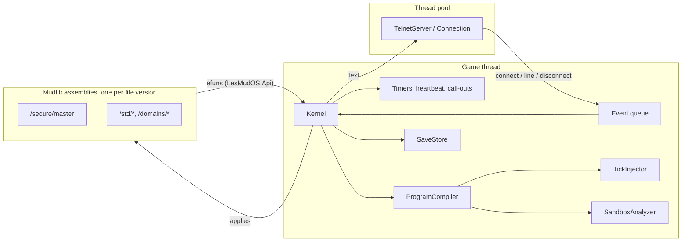

# LesMudOS design

LesMudOS is an LPmud-style game driver written in C#, whose mudlib is also written in C#. It keeps the LP architecture (a small driver, a mudlib of source files that are compiled on demand, and live reloading of a running world) and replaces the LPC language and virtual machine with Roslyn and the .NET runtime.

This document describes the design and says which parts the proof of concept in this repository implements. The API reference is in [DRIVER_API.md](DRIVER_API.md).

## 1. Goals and non-goals

**Goals**

- Every game object is defined by a source file in the mudlib, addressed by path (`/domains/town/square`).
- Files are compiled on first use, with no build step and no restart.
- A wizard can edit a file and `update` it while players are standing in the room.
- The driver knows nothing about rooms, players or combat. All game rules, and all security policy, live in the mudlib.
- A mistake in mudlib code (exception, infinite loop, runaway recursion) is reported to the author and does not take the game down.
- Runs on a small Linux VM as a single process.

**Non-goals**

- Running LPC source. Original mudlibs (2.4.5, Nightmare, Dead Souls and so on) will not run. An LPC-to-C# translator would be a separate project.
- Hosting code from untrusted authors. See [section 8](#8-sandboxing).
- Multi-threaded game logic. World state is owned by one thread.

## 2. LP concepts and their C# form

| LPmud | LesMudOS |
|---|---|
| LPC source file `/std/room.c` | C# source file `/std/room.cs` defining one public class |
| Program (compiled file) | One in-memory assembly per file version, in its own collectible `AssemblyLoadContext` |
| Blueprint object | The instance created by `LoadObject(path)`, named by its path |
| Clone | An instance created by `CloneObject(path)`, named `path#n` |
| `inherit "/std/room";` | `// @inherit /std/room` plus ordinary C# inheritance |
| Object variable that becomes 0 on destruct | `ObjectRef` handle whose `IsAlive` turns false |
| `call_other(ob, "fn", args)` / `ob->fn(args)` | `ob.Call("Fn", args)` |
| efuns | Protected methods on `MudObject` |
| applies (`create`, `init`, `heart_beat`, `id`, `short`, `long`, `catch_tell`) | Virtual methods on `MudObject` |
| `static` (not callable from outside) | `private` / `protected` |
| master object, `valid_read`, `valid_write` | `/secure/master` implementing `IMaster` |
| `add_action`, `query_verb`, `notify_fail`, `input_to` | `AddAction`, `QueryVerb`, `NotifyFail`, `InputTo` |
| `call_out("fn", delay)` | `CallOut(Fn, delay)` with a delegate |
| `save_object` / `restore_object` | `SaveObject` / `RestoreObject` over `[Saved]` fields, stored as JSON |
| eval cost limit | Compile-time tick injection |
| `update` | `UpdateProgram(path)` efun plus a mudlib command that swaps the object |

## 3. Architecture



Three assemblies:

| Assembly | Role |
|---|---|
| `LesMudOS.Api` | The only driver assembly mudlib code can see: `MudObject`, `ObjectRef`, `IMaster`, `[Saved]`. Small on purpose; it is the contract. |
| `LesMudOS.Driver` | The host: kernel, compiler, sandbox analyzer, timers, network, persistence. |
| `lp.<path>.v<n>` | Generated at run time, one per mudlib file version. |

## 4. Compilation pipeline

`ProgramCompiler` turns a mudlib path into a `MudProgram`. It runs on first reference to the path and again after an update.

1. **Resolve dependencies.** Lines of the form `// @inherit /std/room` or `// @use /std/item` name other mudlib files whose types this file needs. Each is compiled first (recursively, with cycle detection). The transitive closure becomes the file's dependency list.
2. **Parse** the file with its real path, so diagnostics and stack traces point at the mudlib file.
3. **Inject ticks** ([section 9](#9-resource-limits)). The rewrite never adds or removes a line break, so line numbers stay correct.
4. **Compile** against a fixed, minimal reference set: `System.Private.CoreLib`, `System.Runtime`, `System.Collections`, `System.Linq`, `LesMudOS.Api`, and the dependency assemblies. A second syntax tree supplies global usings (`System`, `System.Collections.Generic`, `System.Linq`, `System.Text`, `LesMudOS.Api`).
5. **Analyze** against the sandbox allow-list ([section 8](#8-sandboxing)). Any violation fails the compile.
6. **Emit** the assembly and a portable PDB to memory and load them into a new collectible `AssemblyLoadContext`. That context resolves sibling mudlib assemblies to the exact versions the file was compiled against.
7. **Locate the object class.** The file must define exactly one public class derived from `MudObject`. If it is abstract, the program can be inherited but not loaded or cloned.

Compile errors are returned as `path.cs(line,col): CSxxxx: message` and reach whoever triggered the compile.

**Not yet implemented:** an on-disk cache of compiled assemblies keyed by source hash, which would remove the cold-start compile cost on reboot.

## 5. Object model and handles

Every object is an instance of a `MudObject` subclass. Mudlib code never holds that instance. It holds an `ObjectRef`:

- There is exactly one `ObjectRef` per object, so reference equality is identity.
- The kernel keeps all per-object state on the handle: environment, inventory, living flag, command bindings, heartbeat flag, network connection.
- `Destruct` clears the handle's target. Every holder of the handle sees `IsAlive == false` from that moment, and `Call` returns null.
- Objects can only be created by the kernel. `new Sword()` in mudlib code throws, because the `MudObject` constructor requires a pending handle that only `LoadObject` and `CloneObject` set up.

Handles are what make hot reload workable. After `/std/item` is updated, a new item's class is a different .NET type from an old item's class, even though both are called `Item`. A typed reference would break or pin the old assembly in memory. A handle does neither.

### Calling other objects

| Mechanism | When to use |
|---|---|
| `ob.Call("Fn", args)` | The default. Late-bound by name and argument count, so it works across program versions. A missing function returns null, as in LPC. Method lookups are cached per type in a weak table. |
| `ob.As<IFoo>()` where `IFoo` is in `LesMudOS.Api` | Typed and always safe, because the API assembly is never reloaded. |
| `ob.As<Room>()` where `Room` is a mudlib type | Works only while caller and target were compiled against the same version of `/std/room`. Returns null otherwise. Never store the result. |

Only public methods are callable from outside. Efuns are protected, so one object cannot make another object call an efun on its behalf.

## 6. Hot reload

State:

- `current[path]`: the current `MudProgram` for a path, if compiled.
- `objects[name]`: the live objects. A blueprint may have been created from an older program version than `current[path]`.

Rules:

- `LoadObject(path)` returns the existing blueprint if there is one, whatever version it runs. Otherwise it instantiates `current[path]`, compiling if needed.
- `CloneObject(path)` always instantiates `current[path]`.
- `UpdateProgram(path)`:
  1. Asks the master for permission.
  2. Removes `current[p]` for `path` and for every program whose dependency closure contains `path`.
  3. Recompiles `path` immediately, so errors go to the caller. Dependents recompile lazily on next use.
  4. Touches no live object.

Replacing the live object is mudlib policy. The sample `update` command moves the living occupants to `/std/void`, destructs the old blueprint with its remaining contents, loads the new one, and moves the occupants back. If the new source does not compile, step 3 throws before anything has been moved, and the world is untouched.

Old program versions stay loaded while any object created from them is alive. When the last one is destructed, the collectible context becomes unreachable and the runtime unloads it. The `mudstat` command reports how many old versions are still in use and how many have been unloaded.

Consequence to be aware of: after updating a base class, existing objects keep the old base until they are themselves updated or re-cloned. This is the same behaviour as LPmud.

## 7. Execution model

### Threads

One dedicated game thread owns all world state. It takes events from a queue, runs them to completion one at a time, then runs due timers. Network I/O runs on the thread pool and communicates with the game thread only by posting events (`OnConnect`, `OnLine`, `OnDisconnect`) and by writing to per-connection outbound channels. Mudlib code never sees a second thread, and `lock`, `async` and `await` are rejected by the sandbox.

### Execution threads

A top-level execution is one of: a player command, an `InputTo` line, a heartbeat, a call-out, a connect, or a disconnect. For each one the kernel:

1. Resets the tick counter.
2. Sets `ThisPlayer()`: the commanding player, the living object whose heartbeat it is, or the player who was current when the call-out was scheduled.
3. Runs the mudlib code.
4. Catches any exception, logs it with a trimmed stack trace, shows the message to the player, and calls `master.LogError`.

An error aborts the whole execution, as in LPmud. There is no partial rollback: state changed before the error stays changed.

Error reporting happens after the catch block has finished, not inside it. A .NET catch handler runs on top of the faulting stack, and after runaway recursion that stack is nearly full.

### Commands

`AddAction(verb, handler)` binds a verb for `ThisPlayer()`, owned by the calling object. When a player types a line, the kernel walks that player's bindings newest first and calls each matching handler until one returns true. If none does, the player sees the `NotifyFail` message, or `What?`.

Bindings are removed when the owner and the player stop being neighbours (either one moves away or is destructed). A binding owned by an item the player is carrying stays in force as the player moves.

### Init

When object A moves into D, in this order:

1. If A is living, `D.Init()` runs with `ThisPlayer() == A`.
2. For every other object O in D: if A is living, `O.Init()` runs with `ThisPlayer() == A`; if O is living, `A.Init()` runs with `ThisPlayer() == O`.
3. If D is living, `A.Init()` runs with `ThisPlayer() == D`.

This is the LPmud 2.4.5 rule, and it is the mechanism by which rooms offer exits and objects offer verbs.

### Timers

- **Heartbeat:** every 2 seconds, `HeartBeat()` is called on each object that asked for it.
- **Call-outs:** a priority queue ordered by due time. A call-out is skipped if its owner has been destructed.

**Not yet implemented:** `Reset()` (periodic room restocking), swap-out or clean-up of idle objects, and a watchdog that logs executions exceeding a wall-clock budget.

## 8. Sandboxing

LPC is safe by construction: the only way to reach the outside world is through efuns. C# is not, and modern .NET has no in-process security boundary (Code Access Security and AppDomain sandboxing were removed). LesMudOS uses three layers:

1. **Reference set.** Mudlib code is compiled against four framework assemblies and the API. Types in other assemblies (`System.Net.Http`, `System.Diagnostics.Process`, `System.Console`) cannot be named.
2. **Allow-list analyzer.** `System.Private.CoreLib` cannot be left out and contains file I/O, reflection and threading, so after compilation `SandboxAnalyzer` walks the semantic model and checks every referenced symbol and the type of every expression. A type must belong to the mudlib or to an allowed namespace (`System`, `System.Collections`, `System.Collections.Generic`, `System.Linq`, `System.Text`, `LesMudOS.Api`) and must not be on a short deny-list within those (`Type`, `Activator`, `Environment`, `GC`, `AppDomain` and similar). `GetType()`, `typeof`, `goto`, finalizers, `lock`, `await` and unsafe code are rejected outright.
3. **Operating system.** Run the driver as an unprivileged user with a read-only mudlib directory, as in the sample systemd unit.

**Threat model.** This stops honest mistakes and casual misuse. It is not proof against a determined attacker who can write mudlib code: an allow-list over a library as large as CoreLib will have holes. Treat everyone with write access to the mudlib as trusted to the level of the account the driver runs under. Supporting untrusted authors would need a real isolation boundary, which means moving the scripting language off the CLR (for example into a WebAssembly runtime) or running each domain in a separate, confined process.

Policy that LPmud puts in the master object stays there: `ValidRead`, `ValidWrite` and `ValidOperation` gate save files, `update`, `exec`, `shutdown` and destructing other objects.

### Caller identity

The kernel keeps a stack of the objects whose code it has entered: every apply, every `Call`, every action handler, call-out and `InputTo` handler pushes its object. `PreviousObject()` reads that stack, so a security-sensitive function can ask who is calling instead of trusting an argument. The master's checks say which program may use a privileged efun; `PreviousObject()` lets mudlib code such as the wizard registry say which object may call a function.

Direct C# calls between objects (through `As<T>()`) do not push a frame. In that case `PreviousObject()` returns the object the driver entered last, which is the code that made the direct call.

### Wizard levels and the admin secret

Wizard levels (0 to 10) are implemented in the sample mudlib by `/secure/wizlist`, described in DRIVER_API.md section 6. Two points concern the driver:

- **The first level-10 wizard** is created with `promote <secret>`. The secret is read from the `LESMUDOS_ADMIN_SECRET` environment variable at boot and held only as a hash. Mudlib code cannot read it; it can only ask `CheckAdminSecret(candidate)`, and the master restricts that efun to the registry. The registry refuses the bootstrap once any level-10 wizard exists. The secret is kept out of the mudlib because the mudlib is source code in a repository.
- **Guessing** is limited to five wrong attempts per boot, after which the check returns false until the driver is restarted. Attempts are logged. The cost is that any player can use up the attempts and block the bootstrap until a restart, which is acceptable because the bootstrap is needed once.

The secret is typed as a command, so it crosses the network in plain text and may be echoed by the client. Do the bootstrap from the server itself (`telnet localhost`) and then unset the variable.

## 9. Resource limits

The CLR has no instruction counter and no safe way to abort a thread, so the limit is built into the code at compile time. `TickInjector` inserts a call to `Runtime.Tick()`:

- at the start of every loop body (`while`, `do`, `for`, `foreach`), and
- at the start of every method, local function, accessor, constructor, operator and block-bodied lambda. Expression-bodied members are converted to blocks first.

`Tick()` does two things:

- Increments a counter and throws `EvalCostExceededException` past 5,000,000 ticks per execution. Catching the exception does not help runaway code, because the next tick throws again.
- Calls `RuntimeHelpers.EnsureSufficientExecutionStack()`, which throws a catchable exception while there is still stack left. Without this, runaway recursion would raise `StackOverflowException`, which cannot be caught and kills the process. The game thread has a 16 MB stack to give the guard room.

`goto` is rejected because it can form a loop that has no loop body to instrument.

**Known gaps**

- Expression-bodied lambdas are not instrumented. A lambda that recurses through a delegate variable without passing through any instrumented method could overflow the stack.
- Memory is not limited. One statement can allocate a very large array or string.
- A long-running framework call (a pathological `string.Join`, a huge sort) counts as one tick.
- Static fields in mudlib code are shared by all objects of one program version and are reset by an update.

## 10. Persistence

`SaveObject(path)` writes every field marked `[Saved]`, across the class hierarchy, to `save/<path>.json`. `RestoreObject(path)` reads them back and ignores fields that have been added, removed or retyped since. Writes go to a temporary file and are renamed into place. Field types must be plain data. Handles are not persisted, because the objects they refer to do not survive a reboot.

The world itself is not persisted. As in a classic LPmud, rooms and their contents are rebuilt from source by `Create()`, and only what the mudlib explicitly saves (players) survives a restart.

## 11. Networking

A plain TCP listener speaks enough telnet to be used with `telnet`, `nc` or a MUD client: it strips IAC negotiation sequences, assembles lines, handles backspace, and converts `\n` to `\r\n` on output. Each connection has an unbounded outbound channel drained by its own task, so a slow client cannot block the game thread.

**Not yet implemented:** telnet option negotiation (echo off for passwords, NAWS, GMCP), TLS, WebSocket transport, per-connection output limits, idle timeouts and connection throttling.

## 12. Deployment

The driver is a single .NET process. To publish it with its own copy of the runtime for an Ubuntu droplet:

```
dotnet publish src/LesMudOS.Driver -c Release -r linux-x64 --self-contained -o /opt/lesmudos/bin
cp -r mudlib /opt/lesmudos/mudlib
```

and run it under the systemd unit in [`deploy/lesmudos.service`](../deploy/lesmudos.service). The unit is a starting point and has not been tested on a droplet. Single-file publishing is not supported, because the compiler needs the framework assemblies as files on disk. The proof of concept used about 180 MB of resident memory with the sample mudlib loaded and one player connected; most of that is Roslyn. Memory will grow with the number of distinct source files, since each is its own assembly. A 1 GB droplet is enough for the sample; a real mudlib with thousands of files has not been measured.

## 13. Proof-of-concept status

Implemented and covered by `tests/smoke_test.py`:

- On-demand compilation with `@inherit` / `@use` dependencies, three levels deep
- Blueprints, clones, handles, destruct semantics
- Containment tree, `Init` rules, `AddAction` binding and unbinding
- Login hand-off with `Exec`, `InputTo`
- Heartbeats and call-outs
- Live update of a room with players in it, and of a base class with cascading invalidation
- Compile errors reported with file and line, leaving the running world intact
- Unloading of old program versions
- Sandbox analyzer
- Evaluation-cost limit and recursion guard
- Save and restore of `[Saved]` fields
- Master-object policy hooks
- Caller tracking with `PreviousObject()`
- `GetDir`, with wizard commands `pwd`, `cd` and `list` to browse the mudlib
- Wizard levels 0 to 10, level-gated commands, `promote`, and the one-time level-10 bootstrap by admin secret

Not implemented: see the gaps listed in sections 4, 7, 9 and 11, plus shadows, efuns to read and write mudlib files in-game (`ReadFile`, `WriteFile`; only directory listing exists), per-domain privileges (wizard levels are global), and player passwords (anyone can log in under any name, including a wizard's).

## 14. Roadmap

1. **Authoring loop:** in-game file reading and editing gated by the master, a `FileSystemWatcher` option that updates a file when it is saved from an editor, and an on-disk compile cache.
2. **Safety:** player passwords, per-domain privileges, instrumenting expression-bodied lambdas, a wall-clock watchdog, a cap on per-connection output.
3. **World lifecycle:** `Reset()`, clean-up of unused objects, graceful shutdown that saves players.
4. **Protocol:** telnet negotiation, TLS, WebSocket.
5. **Language features:** `async` scripts on a single-threaded scheduler, so that `await Prompt("Name: ")` can replace `InputTo` chains.
6. **Scale test:** generate a few thousand room files and measure boot time, memory and update latency.

## 15. Open decisions

| Decision | Options | Current choice |
|---|---|---|
| Assembly granularity | One per file; one per directory | One per file. Simplest reload semantics; revisit if memory per assembly becomes a problem at scale. |
| Dependency declaration | Comment directive; custom preprocessor; infer from unresolved names | Comment directive. Stays valid C# for IDEs. |
| Late-bound call syntax | `ob.Call("Fn")`; C# `dynamic`; generated interfaces | `Call`. `dynamic` would need `Microsoft.CSharp` in the reference set and widen the sandbox surface. |
| Clone needs a loaded blueprint | Yes (LPmud); no | No. `CloneObject` does not create a blueprint instance. |
| Untrusted authors | Out of scope; WebAssembly isolation; process-per-domain | Out of scope. |
